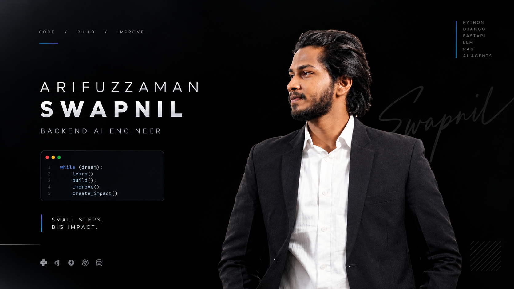

  

  
  
  
  

---

## About Me

**Backend AI Engineer** specialising in **production RAG pipelines** and **LLM-powered applications**. I design and ship scalable Python backends — REST APIs, AI agents, and intelligent chatbots — for live SaaS products across **proptech, construction tech, and logistics**.

- Currently building AI-driven backends at **[Intelleqt AI](https://www.intelleqt.ai/about)** (BaseLinq, HomePlus, TradePilot, TechStyles, TruckWys)
- RAG systems that answer questions over contracts & property documents with **clause-level cited references**
- GPT-4o Vision document analysis and end-to-end AI automation workflows
- Ranked **30th in Bangladesh** in **ITEE (IPA, Japan)** among ~600,000 applicants
- Paper accepted at **IEEE CSDE 2026**
- Dhaka, Bangladesh &nbsp;|&nbsp; English (professional), Bengali (native)
- **Open to collaborations and opportunities in AI/ML engineering**

---

## Experience

| Role | Organization | Period |
|---|---|---|
| **Backend AI Engineer** | [Intelleqt AI](https://www.intelleqt.ai/about) | Feb 2026 – Present |
| **Full-Stack Python Web Developer \| AI Engineer** | [Abedin Tech](https://abedintech.com/our-team/) | Jan 2025 – Feb 2026 |
| **Teaching Assistant** (OOP C++, AI, ML, Neural Networks) | [BUBT](https://www.bubt.edu.bd/) | Oct 2024 – Dec 2025 |

<b>What I do day to day</b>

 

- Build and scale Python backend services and REST/WebSocket APIs powering live SaaS products
- Design RAG pipelines — document ingestion, embeddings, vector search, and cited answers
- Develop LLM-powered AI agents, chatbots, and AI calling systems (GPT-4o, Claude, Gemini)
- Engineer caching and scalability strategies (Redis) and background job pipelines (Celery)
- Integrate payments and billing (Stripe + token economy), Xero, AWS S3, Recall.ai

---

## Featured Projects

### Professional (Live SaaS)

| Project | Description | Stack |
|---|---|---|
| **[BaseLinq AI](https://www.baselinq.ai/)** | Construction project management — Variation Orders, RFIs, Site Instructions, Delay Claims with approval flows, RBAC & cost tracking. Built **Linq AI**, a RAG chatbot with clause-level cited answers, plus AI meeting transcription (Recall.ai + Claude). | Django REST · JWT · React · TS · RAG |
| **[HomePlus](https://www.myhomeplus.io/)** | Home-maintenance platform for UK homeowners with a **GPT-4o Vision** pipeline that reads property documents and produces AI-driven EPC energy ratings. | Django/DRF · React · GPT-4o Vision |
| **[TradePilot](https://www.mytradepilot.io/)** | Trades marketplace & CRM — tradespeople receive, quote, and manage jobs in real time; shares a unified backend with HomePlus. | Django REST · React |
| **[TechStyles](https://www.techstyles.ai/)** | AI-powered interior-design studio & procurement platform with client/contractor portals, CRM, and finance modules. | DRF · Next.js · Xero · AWS S3 · OpenAI |
| **[TruckWys](https://www.truckwys.com/)** | Load-to-cash SaaS for road-freight transporters — load pricing, auto VAT invoicing, debtor tracking, P&L by lane, and an **AI Copilot**. | Django · Fleet APIs · LLM |
| **[Sellanto](https://saleanto.com/)** | AI social media automation across 9 networks — GPT-4o, Claude & Gemini content generation, RAG Messenger chatbot, "Brand DNA" engine, Stripe + token billing. | DRF · Celery · React 19 · TS |

### Open-Source & Research

| Project | Highlights |
|---|---|
| [Animal Image Classification (CNN)](https://github.com/Arifuzzaman-Swapnil/Animal-Classification-CNN) | 30 classes, 3,000 images, **99% accuracy**, Flask deployment — *paper accepted at IEEE CSDE 2026* |
| [RAG Multilingual Bangla AI](https://github.com/Arifuzzaman-Swapnil/Rag-Bangla-AI) | Real-time Bangla Q&A with NLP + FAISS + LLM, **95%+ accuracy** |
| [LLM-Based Career Guidance System](https://github.com/Arifuzzaman-Swapnil/AiCareerAgent) | Career chatbot, resume evaluation, AI interview questions, smart CV builder |
| [Cyberbullying Detection (NLP)](https://github.com/Arifuzzaman-Swapnil/Cyber-Bullying-Sentimental-Analysis-) | Sentiment analysis system detecting cyberbullying in online text |
| [Bangla News Classification](https://github.com/Arifuzzaman-Swapnil/Bangladesh-News-Classification-using-NLP) | NLP-based classifier for Bangla news articles |
| [Bangla Sign Language Sentiment Analysis](https://www.kaggle.com/code/swapnil3051/Bangla_Sign_Language) | Hybrid CNN + NLP model on a Bangla sign language text dataset |

---

## Tech Stack

**Languages**

**Backend & APIs**

 

**AI / LLM Engineering**

**ML & Data**

 

**Frontend**

**Databases**

**Cloud, DevOps & Tools**

 

**Automation**

---

## Awards & Achievements

- **30th Rank in Bangladesh** — ITEE, IPA Japan (Oct 2024), among ~600,000 applicants
- **IEEE CSDE 2026** — Paper accepted (Animal Image Classification using CNN)
- **2nd Prize** — IoT Project Showcase, BUBT (2023)
- **5th Place** — Senior Division, Intra-University Competitive Programming Contest, BUBT (2024)
- **ICPC Regional Contest** — Participated representing BUBT
- **Dean's List**, **Merit Scholarship**, and **Best Project Award** at BUBT

## Certifications

- Natural Language Processing — Innovative Skills BD Ltd.
- Fullstack Laravel Developer — InteractiveCares
- Software Quality Controller — FastFlowUp

## Education

**B.Sc. in Computer Science & Engineering** (Software Engineering Major) — BUBT · 2021–2025 · **CGPA 3.92 / 4.00**
 
HSC — Government Science College · GPA 5.00 / 5.00 &nbsp;|&nbsp; SSC — Shaheed Police Smriti College · GPA 5.00 / 5.00

## Research Interests

`Artificial Intelligence` `Machine Learning` `Deep Learning` `Computer Vision` `NLP` `RAG` `LLM Agents` `Image Processing`

---

## GitHub Stats

  
  
   
  

---

### Let's Connect

**Email:** [md.arifuzzamanswapnil@gmail.com](mailto:md.arifuzzamanswapnil@gmail.com) &nbsp;·&nbsp; **Portfolio:** [md-arifuzzaman-swapnil.vercel.app](https://md-arifuzzaman-swapnil.vercel.app/)

<i>"I don't just write code — I build systems that think."</i>

